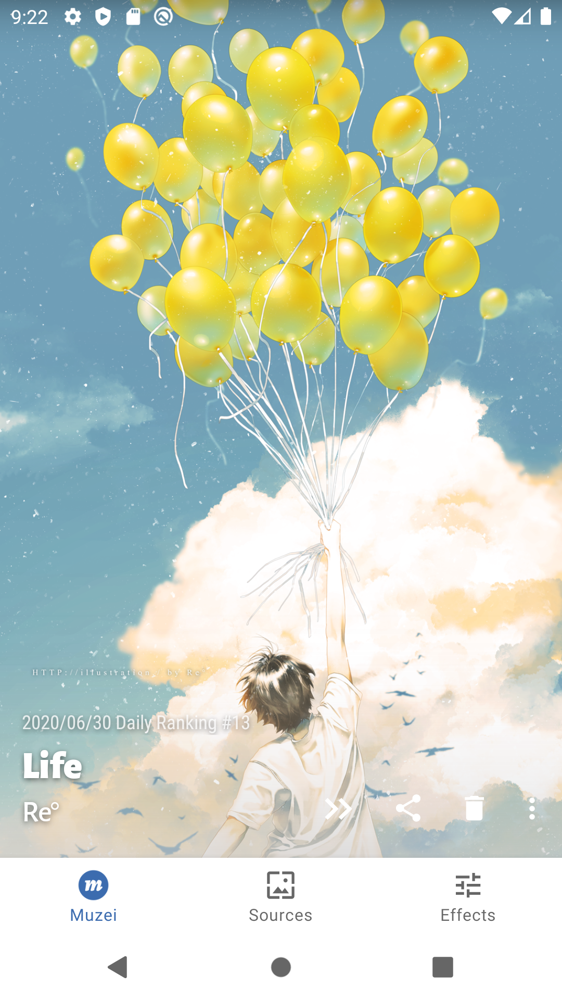
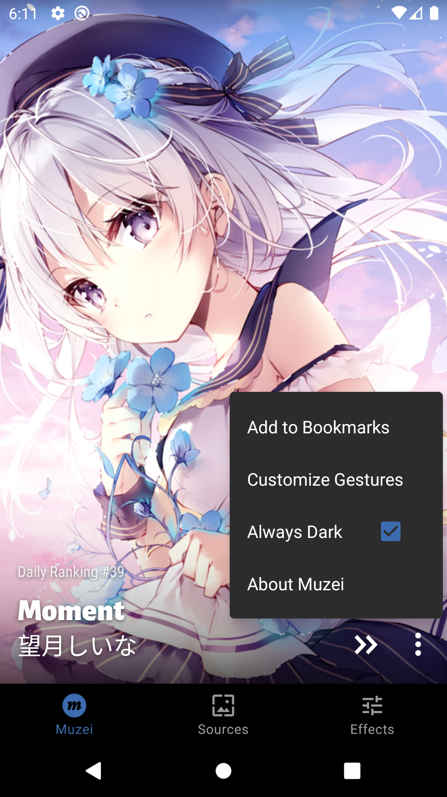
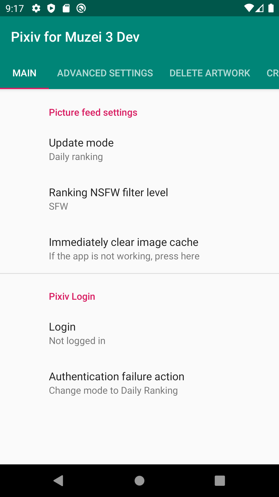
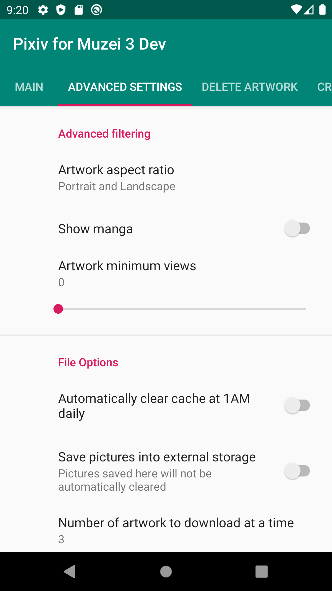
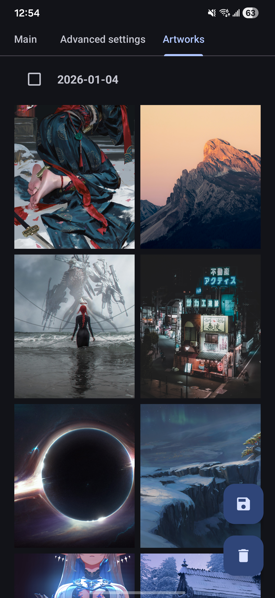
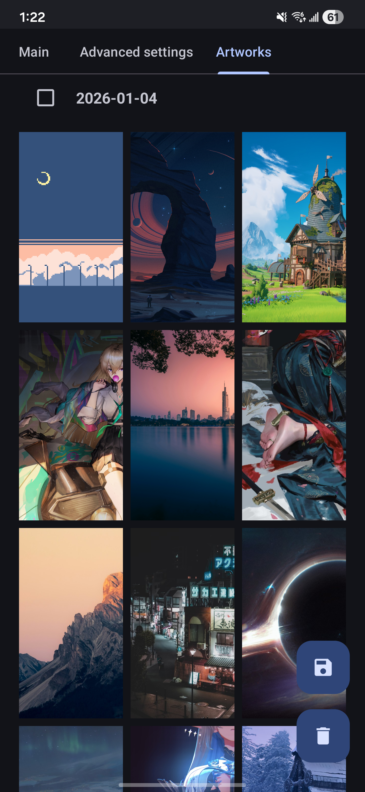

Wallhaven for Muzei
===

[](https://github.com/brewaco3/WallhavenforMuzei3/)

Wallhaven.cc plugin for the Muzei 3 API. Available for download on [GitHub Releases](https://github.com/brewaco3/WallhavenforMuzei3/releases).

Needs [Muzei 3](https://github.com/muzei/muzei) and Android 7.0 (API 24) or newer — Muzei itself does not run
below that.


Features
  - Sorts by toplist (with a range from the last day to the last year), hot, newest, most viewed,
    most favourited, and random
  - Supports SFW, Sketchy, and NSFW purity filters (Sketchy and NSFW require a free
    [API key from Wallhaven Settings](https://wallhaven.cc/settings/account))
  - Filter by multiple criteria: category, search query, aspect ratio, minimum width/height or
    resolution, dominant colour, and random seed
  - Choose how many artworks to download per refresh, and reuse already-fetched candidates instead of
    re-querying the API every time
  - Browse the downloaded artworks, then delete or save several at once
  - Option to automatically clear cache on a daily basis
  - Option to save artwork to external user storage
  - Works on a mobile data saver, behind a mirrored image host if Wallhaven's own is slow
  - No tracking or collection of user data

Credits
---

Wallhaven for Muzei started as a fork of [Pixiv for Muzei 3](https://github.com/yellowbluesky/PixivforMuzei3)
by [yellowbluesky](https://github.com/yellowbluesky) and [alvince](https://github.com/alvince).


License
---

GPL-3.0-or-later, see [LICENSE](LICENSE).









Build instructions
---

1. **Install dependencies**
   - Android Studio (Iguana or newer) with Android SDK Platform 35 and corresponding build tools.
   - Java 17 (bundled with modern Android Studio releases).
   - `adb` from the Android Platform Tools for deploying to a device.
2. **Clone the project and prepare the SDK path**
   ```bash
   git clone https://github.com/brewaco3/WallhavenforMuzei3.git
   cd WallhavenforMuzei3
   ```
   Ensure that `local.properties` contains a valid `sdk.dir=/absolute/path/to/Android/Sdk`. Android Studio populates this automatically when you open the project; for command-line builds you can create the file manually.
3. **Build a debug APK**
   ```bash
   ./gradlew :app:assembleDevDebug
   ```
   The resulting APK is written to `app/build/outputs/apk/dev/debug/app-dev-debug.apk`. The `dev` flavor
   adds a `.dev` suffix to the application ID, so it can be installed next to a release build.
4. **(Optional) Build a release APK**
   Create `keystore.properties` in the project root with `storeFile`, `storePassword`, `keyAlias` and
   `keyPassword`, then run:
   ```bash
   ./gradlew :app:assembleProdRelease
   ```
   The signed artifact is located under `app/build/outputs/apk/prod/release/`.
5. **Install on a device**
   Enable developer options and USB debugging on your Android phone, connect it via USB, then run:
   ```bash
   adb install -r app/build/outputs/apk/dev/debug/app-dev-debug.apk
   ```
   Replace the APK path with the release variant if you built a signed package.
6. **Run the unit tests**
   ```bash
   ./gradlew :app:testDevDebugUnitTest
   ```
